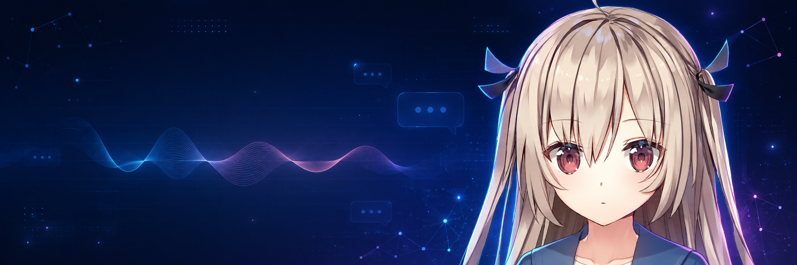
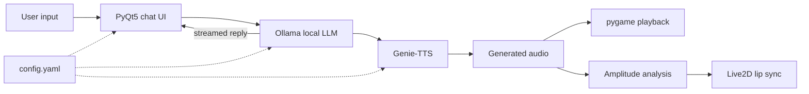

<div align="center">
  
  <h1>ATRI Chatbot</h1>
  <p><strong>A local-first Live2D voice companion powered by Ollama and Genie-TTS.</strong></p>
  <p>
    <a href="README.zh-CN.md">简体中文</a> ·
    <a href="#quick-start">Quick start</a> ·
    <a href="#how-it-works">Architecture</a>
  </p>
  <p>
    
    
    
    
    
  </p>
</div>

ATRI Chatbot is an experimental desktop companion that combines a locally served language model, a Live2D avatar, and offline speech synthesis in one PyQt5 interface. Replies stream from Ollama, Genie-TTS generates the voice, and the audio amplitude drives real-time lip sync.

> Built as a robotics and human-computer interaction project at the School of Robotics, South China University of Technology.

## Highlights

| Capability | Implementation |
| --- | --- |
| Local conversation | Ollama HTTP API with streamed responses and short-term context |
| Animated character | Live2D rendering inside a PyQt5 OpenGL widget |
| Local speech | Genie-TTS ONNX inference with user-provided reference audio |
| Lip sync | Real-time mouth movement estimated from playback amplitude |
| Configurable setup | Models, names, backgrounds, and endpoints live in a local YAML file |

## How it works



## Quick start

### 1. Prerequisites

- Windows 10 or 11
- Python 3.9
- [Ollama](https://ollama.com/)
- A compatible Genie-TTS ONNX model and reference audio

### 2. Install

```powershell
git clone https://github.com/Edenmzpy/ATRI_Chatbot.git
cd ATRI_Chatbot
./setup.bat
```

`setup.bat` creates the virtual environment, installs dependencies, and copies `config.example.yaml` to the ignored local file `config.yaml`.

### 3. Prepare the Ollama character

Make sure Ollama is running, then create the local model from the included `ATRI` Modelfile:

```powershell
ollama pull openllm/causallm
ollama create ATRI -f ATRI
```

The name in `ollama create` must match `chat_model` in `config.yaml` (`:latest` is implicit).

### 4. Prepare Genie-TTS

Place your model files in the ignored model directories, then convert them if needed:

```powershell
venv\Scripts\python -c "import genie_tts as genie; genie.convert_to_onnx('GPT_weights_v2/your_model.ckpt', 'SoVITS_weights_v2/your_model.pth', 'onnx_model/your-character')"
```

Add a short reference `.wav` file under `ref/`, and set its exact transcript in `ref_prompt_text`.

### 5. Configure and launch

Edit `config.yaml` to match your local model and audio paths, then run:

```powershell
./gui.bat
```

## Configuration

| Key | Purpose |
| --- | --- |
| `dialog_url` | Ollama generate endpoint |
| `chat_model` | Ollama model name |
| `live2d_model` | Model path relative to `Live_2d_models/` |
| `character_name` | Genie-TTS speaker identifier |
| `onnx_model_dir` | Converted ONNX model directory |
| `ref_audio_path` | Reference speech audio |
| `ref_prompt_text` | Exact transcript of the reference audio |

See [`config.example.yaml`](config.example.yaml) for every available setting.

## Project layout

```text
ATRI_Chatbot/
├── gui.py                 # UI, Ollama client, TTS, and lip sync
├── ATRI                   # Ollama Modelfile
├── config.example.yaml    # Safe configuration template
├── setup.bat              # Environment bootstrap
├── gui.bat                # Application launcher
├── Live_2d_models/        # Live2D assets
├── icon_image/            # Window icon
├── chat_background/       # Chat panel background
├── live2d_background/     # Avatar background
└── ref/                   # User-provided reference audio
```

## Current limitations

- The setup and launch scripts currently target Windows.
- Model weights and reference audio are intentionally not included.
- The application expects Ollama and all local model assets to be prepared before launch.
- This is an experimental project rather than a packaged consumer application.

## Notice

This is an unofficial, non-commercial fan project. ATRI and related character or visual assets belong to their respective rights holders. Unless a separate license is provided, the repository contents are not granted for redistribution or commercial reuse.
