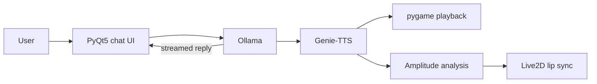

<div align="center">


# ATRI Chatbot

**A local-first Live2D voice companion — Ollama for the mind, Genie-TTS for the voice.**

[English](README.md) · [简体中文](README.zh-CN.md)


</div>

---

A PyQt5 desktop companion that runs entirely on your machine: replies stream from a local Ollama model, Genie-TTS speaks them offline, and the audio amplitude drives the Live2D avatar's lip sync in real time.

## Features

- **Local conversation** — Ollama HTTP API, streamed replies, short-term context
- **Animated avatar** — Live2D rendered in a PyQt5 OpenGL widget
- **Offline voice** — Genie-TTS ONNX inference from a short reference clip
- **Lip sync** — mouth movement follows playback amplitude
- **One config file** — models, names, backgrounds and endpoints in `config.yaml`

## How it works



## Quick start

**Requirements:** Windows 10/11 · Python 3.9 · [Ollama](https://ollama.com/) · a Genie-TTS ONNX model + reference audio

```powershell
# 1. Install
git clone https://github.com/Edenmzpy/ATRI_Chatbot.git
cd ATRI_Chatbot
./setup.bat                      # creates venv, installs deps, copies config.yaml

# 2. Create the character model (Ollama must be running)
ollama pull openllm/causallm
ollama create ATRI -f ollama/ATRI.Modelfile

# 3. Convert your GPT-SoVITS weights to ONNX (once)
venv\Scripts\python -c "import genie_tts as genie; genie.convert_to_onnx('GPT_weights_v2/your_model.ckpt', 'SoVITS_weights_v2/your_model.pth', 'onnx_model/your-character')"

# 4. Put a short reference .wav in ref/, edit config.yaml, then launch
./gui.bat
```

The `ollama create` name must match `chat_model` in `config.yaml` (`:latest` is implicit).

## Configuration

| Key | Purpose |
| --- | --- |
| `dialog_url` | Ollama generate endpoint |
| `chat_model` | Ollama model name |
| `live2d_model` | Model path relative to `assets/live2d/` |
| `character_name` | Genie-TTS speaker id |
| `onnx_model_dir` | Converted ONNX model directory |
| `ref_audio_path` / `ref_prompt_text` | Reference audio and its exact transcript |

Full template: [`config.example.yaml`](config.example.yaml)

## Project layout

```text
ATRI_Chatbot/
├── gui.py                  # UI, Ollama client, TTS and lip sync
├── config.example.yaml     # Configuration template
├── setup.bat · gui.bat     # Setup and launch scripts
├── ollama/
│   └── ATRI.Modelfile      # Character persona for Ollama
├── assets/
│   ├── live2d/atri/        # Live2D model
│   ├── backgrounds/        # Chat and avatar backgrounds
│   └── icons/              # Window icons
├── ref/                    # Your reference audio (git-ignored)
└── docs/assets/            # README artwork
```

## Limitations

- Windows only for now (setup and launch scripts).
- Model weights and reference audio are not included.
- Ollama and all model assets must be ready before launch.
- Experimental project, not a packaged application.

## Notice

Unofficial, non-commercial fan project. ATRI and related character and visual assets belong to their respective rights holders. Without a separate license, the repository contents are not licensed for redistribution or commercial use.
