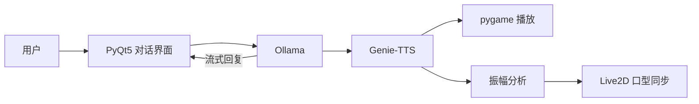

<div align="center">


# ATRI Chatbot

**本地运行的 Live2D 语音伙伴：Ollama 负责对话，Genie-TTS 负责声音。**

[English](README.md) · [简体中文](README.zh-CN.md)


</div>

---

一个完全在本机运行的 PyQt5 桌面伙伴：本地 Ollama 模型流式生成回复，Genie-TTS 离线合成语音，音频振幅实时驱动 Live2D 角色的口型。

## 功能

- **本地对话**：Ollama HTTP 接口，流式输出，保留短期上下文
- **动态角色**：在 PyQt5 OpenGL 控件中渲染 Live2D
- **离线语音**：基于一段参考音频的 Genie-TTS ONNX 推理
- **口型同步**：嘴型跟随播放音量变化
- **单一配置**：模型、名称、背景和接口地址都在 `config.yaml` 中

## 工作流程



## 快速开始

**环境要求：** Windows 10/11 · Python 3.9 · [Ollama](https://ollama.com/) · Genie-TTS ONNX 模型与参考音频

```powershell
# 1. 安装
git clone https://github.com/Edenmzpy/ATRI_Chatbot.git
cd ATRI_Chatbot
./setup.bat                      # 创建 venv、安装依赖、生成 config.yaml

# 2. 创建角色模型（需先启动 Ollama）
ollama pull openllm/causallm
ollama create ATRI -f ollama/ATRI.Modelfile

# 3. 将 GPT-SoVITS 权重转换为 ONNX（只需一次）
venv\Scripts\python -c "import genie_tts as genie; genie.convert_to_onnx('GPT_weights_v2/your_model.ckpt', 'SoVITS_weights_v2/your_model.pth', 'onnx_model/your-character')"

# 4. 把参考 .wav 放进 ref/，修改 config.yaml 后启动
./gui.bat
```

`ollama create` 的名称需与 `config.yaml` 中的 `chat_model` 一致（`:latest` 可省略）。

## 配置说明

| 配置项 | 用途 |
| --- | --- |
| `dialog_url` | Ollama 生成接口地址 |
| `chat_model` | Ollama 模型名称 |
| `live2d_model` | 相对于 `assets/live2d/` 的模型路径 |
| `character_name` | Genie-TTS 说话人标识 |
| `onnx_model_dir` | 转换后的 ONNX 模型目录 |
| `ref_audio_path` / `ref_prompt_text` | 参考音频及其准确文本 |

完整模板：[`config.example.yaml`](config.example.yaml)

## 项目结构

```text
ATRI_Chatbot/
├── gui.py                  # 界面、Ollama 客户端、TTS 与口型同步
├── config.example.yaml     # 配置模板
├── setup.bat · gui.bat     # 安装与启动脚本
├── ollama/
│   └── ATRI.Modelfile      # Ollama 角色设定
├── assets/
│   ├── live2d/atri/        # Live2D 模型
│   ├── backgrounds/        # 对话区与角色区背景
│   └── icons/              # 窗口图标
├── ref/                    # 自备参考音频（不纳入版本管理）
└── docs/assets/            # README 图片
```

## 当前限制

- 目前仅支持 Windows（安装与启动脚本）。
- 不包含模型权重和参考音频。
- 启动前需准备好 Ollama 及全部模型资源。
- 实验性项目，并非封装完整的桌面应用。

## 版权说明

非官方、非商业的同人项目。ATRI 及相关角色、视觉素材的权利归各自权利人所有。在另行提供许可证之前，仓库内容不授权再分发或商业使用。
