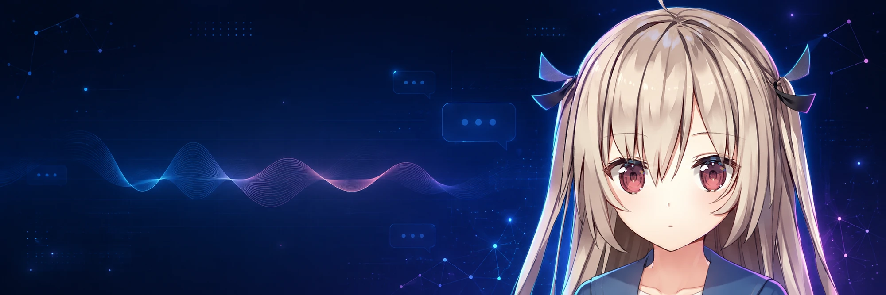
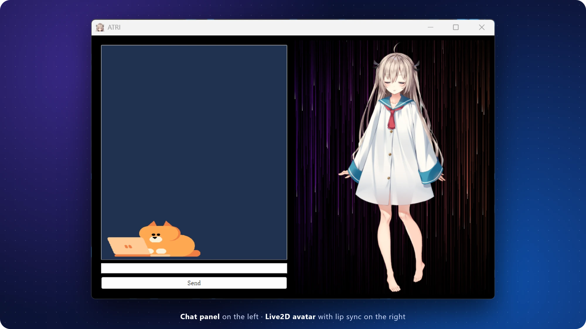
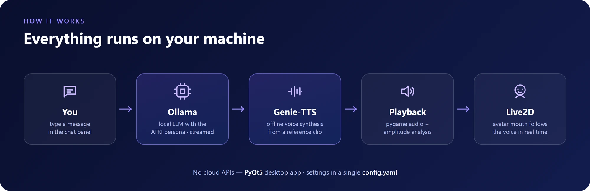

<div align="center">



# ATRI Chatbot

**完全在本机运行的 Live2D 语音伙伴。**

[English](README.md) · **简体中文**


</div>





## 快速开始

**需要：** Windows 10/11 · Python 3.9 · [Ollama](https://ollama.com/) · Genie-TTS（GPT-SoVITS）声音模型 + 一段参考 `.wav`

```powershell
git clone https://github.com/Edenmzpy/ATRI_Chatbot.git
cd ATRI_Chatbot
./setup.bat                                    # 创建 venv、安装依赖、生成 config.yaml

ollama pull openllm/causallm
ollama create ATRI -f ollama/ATRI.Modelfile    # 角色设定

./gui.bat                                      # 启动
```

启动前：把转换好的声音模型放进 `onnx_model/`，参考音频放进 `ref/`，并在 `config.yaml` 中填好路径。

<details>
<summary>将 GPT-SoVITS 权重转换为 ONNX</summary>

```powershell
venv\Scripts\python -c "import genie_tts as genie; genie.convert_to_onnx('GPT_weights_v2/your_model.ckpt', 'SoVITS_weights_v2/your_model.pth', 'onnx_model/your-character')"
```
</details>

<details>
<summary>配置项</summary>

| 配置项 | 用途 |
| --- | --- |
| `chat_model` | Ollama 模型名，需与 `ollama create` 一致 |
| `dialog_url` | Ollama 生成接口地址 |
| `live2d_model` | `assets/live2d/` 下的模型路径 |
| `character_name` · `onnx_model_dir` | Genie-TTS 说话人与模型目录 |
| `ref_audio_path` · `ref_prompt_text` | 参考音频及其准确文本 |

完整模板：[`config.example.yaml`](config.example.yaml)
</details>

## 项目结构

```text
gui.py                  界面、Ollama 客户端、TTS 与口型同步
ollama/ATRI.Modelfile   角色设定
assets/                 Live2D 模型、背景、图标
config.example.yaml     配置模板
setup.bat · gui.bat     安装 / 启动
```

## 声明

实验性同人项目，仅支持 Windows；不包含模型权重和声音素材。ATRI 及相关角色素材归各自权利人所有，不授权再分发或商业使用。
