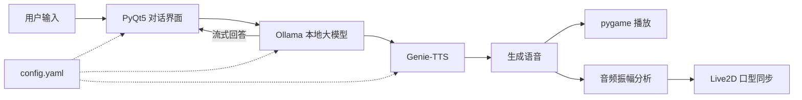

<div align="center">
  
  <h1>ATRI Chatbot</h1>
  <p><strong>基于 Ollama、Live2D 与 Genie-TTS 的本地桌面语音伙伴。</strong></p>
  <p>
    <a href="README.md">English</a> ·
    <a href="#快速开始">快速开始</a> ·
    <a href="#工作流程">项目架构</a>
  </p>
  <p>
    
    
    
    
    
  </p>
</div>

ATRI Chatbot 是一个本地优先的桌面人机交互实验项目。它将 Ollama 对话模型、Live2D 角色渲染和 Genie-TTS 离线语音合成整合到同一个 PyQt5 界面中：回答可以流式显示，生成的声音会同步驱动角色口型。

> 华南理工大学机器人学院机器人与人机交互方向的个人实践项目。

## 项目亮点

| 能力 | 实现方式 |
| --- | --- |
| 本地对话 | 通过 Ollama HTTP API 流式生成，并保留短期上下文 |
| 动态角色 | 在 PyQt5 OpenGL 控件中渲染 Live2D 模型 |
| 本地语音 | 使用 Genie-TTS ONNX 模型和用户自备参考音频 |
| 实时口型 | 根据播放音频的振幅实时控制角色嘴部参数 |
| 灵活配置 | 模型、角色名、背景和接口地址统一写入本地 YAML 文件 |

## 工作流程



## 快速开始

### 1. 环境要求

- Windows 10 或 11
- Python 3.9
- [Ollama](https://ollama.com/)
- 可用的 Genie-TTS ONNX 模型与参考音频

### 2. 安装依赖

```powershell
git clone https://github.com/Edenmzpy/ATRI_Chatbot.git
cd ATRI_Chatbot
./setup.bat
```

`setup.bat` 会创建虚拟环境、安装依赖，并将 `config.example.yaml` 复制为不会提交到仓库的本地配置 `config.yaml`。

### 3. 准备 Ollama 角色

确认 Ollama 已经启动，然后用仓库内的 `ATRI` Modelfile 创建角色模型：

```powershell
ollama pull openllm/causallm
ollama create ATRI -f ATRI
```

`ollama create` 使用的名称需要与 `config.yaml` 中的 `chat_model` 一致；`:latest` 标签可以省略。

### 4. 准备 Genie-TTS

将模型权重放入被忽略的本地模型目录。如需转换为 ONNX，可运行：

```powershell
venv\Scripts\python -c "import genie_tts as genie; genie.convert_to_onnx('GPT_weights_v2/your_model.ckpt', 'SoVITS_weights_v2/your_model.pth', 'onnx_model/your-character')"
```

把一段简短的参考 `.wav` 音频放进 `ref/`，并在 `ref_prompt_text` 中填写与音频完全一致的文字。

### 5. 配置并启动

修改 `config.yaml`，使模型与音频路径符合本机环境，然后运行：

```powershell
./gui.bat
```

## 配置说明

| 配置项 | 用途 |
| --- | --- |
| `dialog_url` | Ollama 文本生成接口地址 |
| `chat_model` | Ollama 模型名称 |
| `live2d_model` | 相对于 `Live_2d_models/` 的模型路径 |
| `character_name` | Genie-TTS 说话人标识 |
| `onnx_model_dir` | 转换后的 ONNX 模型目录 |
| `ref_audio_path` | 参考语音路径 |
| `ref_prompt_text` | 参考语音的准确文本 |

全部设置可参考 [`config.example.yaml`](config.example.yaml)。

## 项目结构

```text
ATRI_Chatbot/
├── gui.py                 # 界面、Ollama、TTS 与口型同步
├── ATRI                   # Ollama Modelfile
├── config.example.yaml    # 安全的配置模板
├── setup.bat              # 环境初始化脚本
├── gui.bat                # 程序启动脚本
├── Live_2d_models/        # Live2D 资源
├── icon_image/            # 窗口图标
├── chat_background/       # 对话区背景
├── live2d_background/     # 角色区背景
└── ref/                   # 用户自备参考音频
```

## 当前限制

- 初始化与启动脚本目前主要面向 Windows。
- 模型权重和参考音频需要用户自行准备，不随仓库分发。
- 启动程序前需要先运行 Ollama，并准备好全部本地模型资源。
- 当前版本属于实验性项目，还不是完整封装的桌面产品。

## 版权说明

本项目为非官方、非商业性质的同人实践。ATRI 及相关角色与视觉素材的权利归各自权利人所有。在仓库另行提供许可证之前，仓库内容不视为已授权再分发或商业使用。
